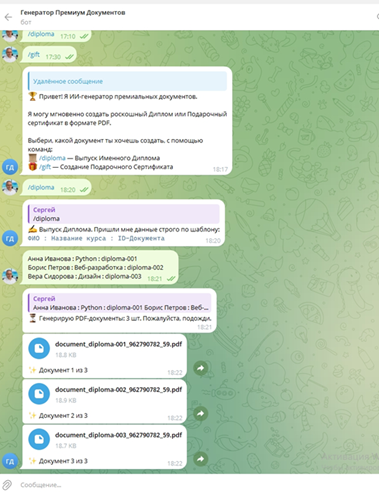

# Telegram PDF Document Bot



Учебный Telegram-бот на Python для пакетного создания именных дипломов и
подарочных сертификатов в PDF из HTML-шаблонов. PDF генерируются с помощью
WeasyPrint, отправляются в Telegram и сохраняются локально.

## Результат генерации

* 📄 [Посмотреть пример готового Диплома](./result_diploma.pdf)
* 📄 [Посмотреть пример готового Подарочного сертификата](./result_certificate.pdf)

## Возможности

- Выпуск дипломов и подарочных сертификатов по командам `/diploma` и `/gift`.
- Генерация до 10 документов из одного сообщения.
- Доступ к выпуску только для разрешённых Telegram ID и только в личном чате.
- Учёт использованных ID в SQLite и ограничение выпуска до 10 PDF за 10 минут
  на оператора.
- Сохранение PDF в `output/`, повторная отправка через `/resend ID`.
- Удаление PDF по сроку хранения без удаления записи о выданном ID.
- HTML-экранирование данных пользователя и блокировка внешних ресурсов
  при рендеринге.

## Быстрый старт

Требуется Python 3.10 или новее. В PowerShell из папки проекта:

```powershell
python -m venv .\venv
.\venv\Scripts\Activate.ps1
python -m pip install -r .\requirements.txt
Copy-Item .\.env.example .\.env
```

Заполните `.env`: добавьте токен BotFather в `BOT_TOKEN` и свой Telegram ID
в `ALLOWED_USER_IDS`. Для получения ID запустите бота и отправьте `/myid`.
Затем выполните:

```powershell
python .\bot_generator.py
```

Подробные инструкции по настройке, командам, формату пакетных данных, хранению
PDF, безопасности и устранению неполадок находятся в
[руководстве пользователя](./docs/USER_GUIDE.md).

## Структура проекта

```text
VPa06/
├── bot_generator.py
├── templates/
├── tests/
├── docs/
├── output/          # создаётся при запуске; исключена из Git
├── .env.example
├── requirements.txt
└── LICENSE
```

Запуск тестов:

```powershell
python -m unittest discover -s .\tests -v
```

## Безопасность и лицензия

Не добавляйте настоящий `.env`, токены, PDF и содержимое `output/` в Git.
Пример настроек находится в [`.env.example`](./.env.example), локальные секреты
и документы исключаются через [`.gitignore`](./.gitignore).

Код и материалы проекта, права на которые принадлежат автору, распространяются
по MIT; см. [LICENSE](./LICENSE). Зависимости имеют собственные лицензии:
например, `pyTelegramBotAPI` распространяется по GPL-2.0. Перед распространением
или продажей приложения проверьте лицензионные требования всех компонентов и
убедитесь, что у вас есть права на опубликованные шаблоны и другие материалы.
